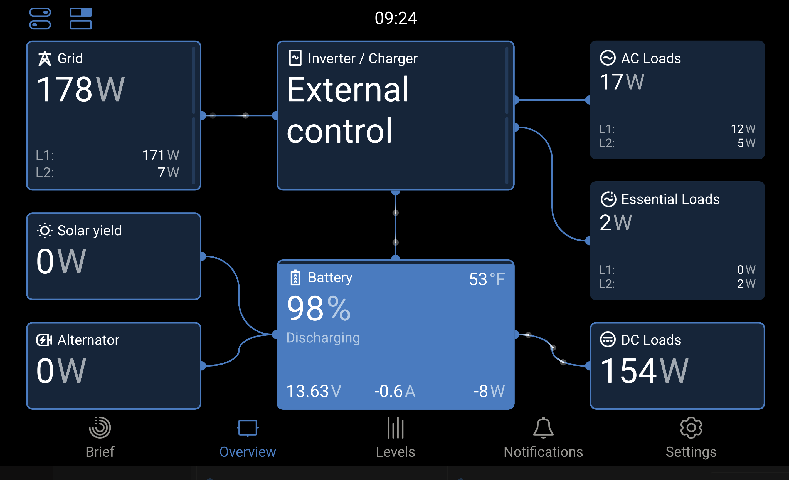
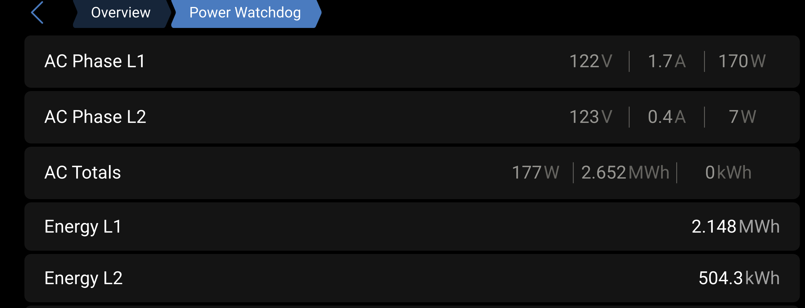
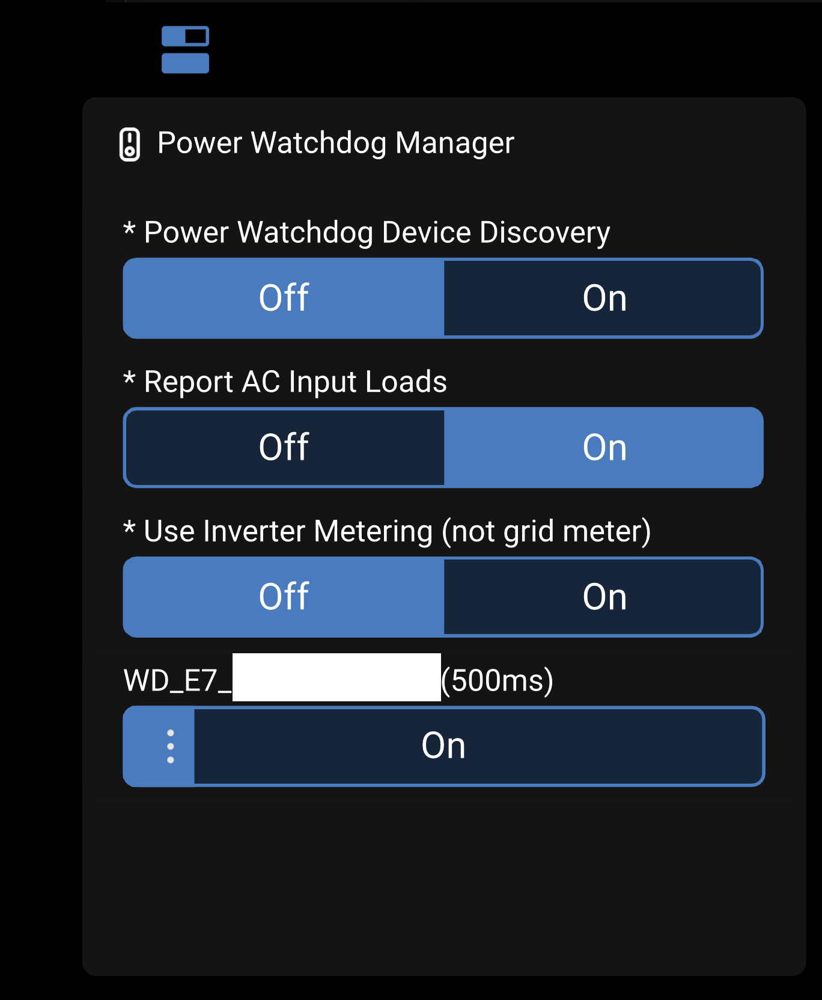

# dbus-power-watchdog

Venus OS service that discovers and manages Hughes Power Watchdog surge
protectors via Bluetooth Low Energy.

## Overview

A single-process Venus OS service that scans BLE for Power Watchdog devices
and presents them as dimmable switches in the Venus OS switches pane.  When
a device is enabled, the service connects to it via BLE and publishes
L1/L2 AC voltage, current, power, energy, and frequency to the Venus OS
D-Bus.

**Only one Power Watchdog device may be active at a time.**  Enabling a
device automatically disables any previously active one.  Each device's
switch includes a slider to control the polling interval (100ms-10000ms).

Supports role assignment as a grid meter, generator meter, or PV inverter
meter.  Settings (role, custom name, position, polling interval) are
persisted via `com.victronenergy.settings` and survive reboots.

Supports both 30A (single-line) and 50A (dual-line L1+L2) Power Watchdog
models, including gen1 (BT-only) and gen2 (WiFi+BT) hardware.

### Cerbo GX Screenshots

**Overview dashboard** — Power Watchdog reporting as the grid meter (178W across L1+L2), with AC Loads, Essential Loads, DC Loads, battery, and inverter status all visible:



**Power Watchdog device detail** — per-phase AC voltage, current, power, and cumulative energy totals:



**Switch panel** — Discovery toggle, system setting overrides, and the per-device polling interval slider (shown at 500ms):



## Architecture

```
dbus-power-watchdog.py          (single process — discovery + BLE + grid service)
  ├─ Registers as com.victronenergy.switch.power_watchdog
  ├─ Presence source, chosen at startup (see "Presence" below):
  │    ├─ router: dbus-ble-sensors-py's advertisement router tells us when a
  │    │  unit is heard; no scanner of ours runs, discovery toggle hidden
  │    └─ scan:   our own BleakScanner discovery + offline poll (no router)
  ├─ Discovery toggle in Venus OS switches pane (scan mode)
  ├─ Per-device dimmable switches (on/off + polling interval slider)
  ├─ "Report AC Input Loads" system toggle (HasAcInLoads)
  ├─ "Use Inverter Metering" system toggle (RunWithoutGridMeter)
  └─ When a device is enabled:
       ├─ Resolves the device (BlueZ cache first, then a scan)
       ├─ Connects via bleak-retry-connector, routed underneath by
       │  bleak-connection-manager v2 (the "bleak catcher")
       │    ├─ bleak.BleakClient rebound process wide at startup
       │    ├─ Claim-aware adapter selection (/run/bt-claims, bt-claims
       │    │  convention — other BLE services on the GX see our use)
       │    ├─ Per-adapter link slots (ble_link_caps) and failure-driven
       │    │  rotation for pinned devices
       │    ├─ Post-connect validation: a link whose GATT is not a Power
       │    │  Watchdog is torn down and retried on the next radio
       │    └─ habluetooth connection-parameter tuning over the mgmt socket
       ├─ NotificationWatchdog tears the session down on a silent link
       └─ Registers com.victronenergy.grid.power_watchdog_{mac_id}
```

Only one device may be active at a time.  Enabling a second device
automatically disables the first.  `power_watchdog_device.py` is retained
as a standalone fallback for manual use.

## Sensors

- **Line 1**: Voltage (V), Current (A), Power (W), Energy (kWh), Frequency (Hz)
- **Line 2**: Voltage (V), Current (A), Power (W), Energy (kWh), Frequency (Hz)
- **Combined**: Total Power (W), Total Current (A), Average Voltage (V), Total Energy (kWh)
- **Error Code**: 0-9 (see Hughes documentation)

## D-Bus Paths

Each enabled device registers as `com.victronenergy.grid.power_watchdog_{mac}`
(or `genset`/`pvinverter` depending on role).

| Path | Description |
|------|-------------|
| `/Role` | Current role (writable: `grid`, `pvinverter`, `genset`) |
| `/AllowedRoles` | Available roles |
| `/Position` | PV inverter position (writable, only used when role=pvinverter) |
| `/CustomName` | User-defined name (writable, persisted) |
| `/NrOfPhases` | Number of phases (1 or 2, auto-detected) |
| `/RefreshTime` | Measurement interval in milliseconds |
| `/Ac/L1/*` | Line 1 measurements |
| `/Ac/L2/*` | Line 2 measurements (50A models) |
| `/Ac/Power` | Total AC power (W) |
| `/ErrorCode` | Current error code |
| `/Connected` | 1 while the BLE link to the Power Watchdog is up, 0 while it is offline and retrying |
| `/LastUpdate` | Unix time of the last parsed frame from the device (refreshed at most once per 60 s) |

Read the device's health from the **grid** service: `/Connected` for the link,
and `now - /LastUpdate` for whether frames are still arriving. The separate
`com.victronenergy.switch.power_watchdog` service is the manager (discovery and
the per-device enable switches), so its own `/Connected` describes the manager
and stays 1 while the device is off.

The live measurements (`/Ac/L1/*`, `/Ac/L2/*` and the totals, except the
energy counters) are published as one frame, only when a reading has moved a
full hysteresis band since the last published frame, a value goes to or from
zero, or another path (an energy tick, an alarm, `/Connected`, the
once-a-minute `/LastUpdate`) changes. A steady load therefore shows a held
value that is at most a minute old. The bands and display steps are the
`GRID_*_BAND` and `GRID_*_STEP` constants in `grid_publisher.py`.

## Device Discovery

Units are classified by their BLE name:

| Generation | BLE Name Pattern | Example |
|------------|-----------------|---------|
| Gen2 (WiFi+BT) | `WD_{type}_{serial}` | `WD_E7_aabbccddeeff` |
| Gen1 (BT-only) | `PM{S\|D}...` (19 chars) | `PMD...` (50A), `PMS...` (30A) |

How a name gets in front of the classifier depends on the presence source
(next section).  In **scan** mode, discovery scans use plain `BleakScanner`
on the configured adapter; set `ble_wrap_scanner = true` to route them
through the connection manager's adapter-bound, claiming scanner instead.
In **router** mode there is no scan: a unit the router hears is looked up
in BlueZ's device cache for its name.

## Presence: the advertisement router, or our own scans

Two questions need answering all the time: *is the enabled unit there?*
(so the BLE session knows when to connect) and *is there a unit we have
not seen before?* (discovery).  There are two ways to answer them, chosen
once at startup by `presence_source` (default `auto`):

| Source | Chosen when | Presence of the enabled unit | Discovery |
|--------|-------------|------------------------------|-----------|
| `router` | [dbus-ble-sensors-py](https://github.com/TechBlueprints/venus-os-dbus-ble-sensors-py) (or the standalone `dbus-ble-advertisements`) is installed — detected by its `/service/` entry | `Advertisement` signals from the router; while the unit is away the session waits to be told, no scanning | From the same signals; the discovery toggle is hidden |
| `scan` | No router provider installed | BlueZ cache, then a 20 s scan, repeated every 5 min while the unit is away | Timer-driven `BleakScanner` discovery behind the toggle |

**Why detect by installed files rather than by the bus.**  runit starts
services in no particular order, so at our startup the router may simply
not be up yet.  The *mode* therefore follows what is installed; whether the
router is *running* is tracked live via `NameOwnerChanged`.  Until it
appears — and whenever it goes away — the BLE session behaves exactly as
in `scan` mode for the enabled unit, and switches to waiting on the router
the moment its bus name shows up.

**How router mode works.**  A Power Watchdog advertises Hughes'
manufacturer ID (`0x2312`) whenever it is powered and not connected.  We
export registration objects under `/ble_advertisements/power_watchdog/`
on our own bus name — `mfgr/8978` for every unit, plus `addr/<MAC>` for
each unit already in settings — *before* claiming the name, because the
router introspects a service the moment its name appears.  Each matching
advertisement arrives as a D-Bus signal carrying the MAC and the adapter
that heard it.  For the enabled unit that signal ends the offline wait
(and hints which adapter to resolve on, when the config names none); for
an unknown MAC we read the name BlueZ has cached for it and classify as
usual.  The immediate reconnect after a link drop is unchanged — the unit
was there a moment ago and BlueZ most likely still has it — only the
"unit is away" poll is replaced.

**Safety net.**  While waiting on the router the session still makes one
blind resolve every `presence_fallback_interval` (default 900 s).  That
covers a router that has stopped emitting, and gen1 `PM*` units, whose
advertisement is not confirmed to carry any manufacturer data the router
could match on.  900 s is also the router's own keepalive period for a
unit advertising constant data, so nothing it *can* hear waits longer.

**Known limits of router mode.**  The router only forwards manufacturer
data, not the local name, and only re-introspects us when our bus name
appears — so `addr/` registrations added for a unit discovered at runtime
take effect at the router's next restart (harmless: the `mfgr/` path
already carries it).  A gen1 unit with no manufacturer data can neither be
discovered nor heard through the router; it still connects via the blind
fallback, and `presence_source = scan` restores the old behaviour
entirely.

## Requirements

- Venus OS >= 3.x (Cerbo GX or similar)
- Hughes Power Watchdog with Bluetooth (gen1 or gen2)
- BLE adapter available on the GX device (one or two HCI adapters)
- Python 3 (included with Venus OS)
- Git (for cloning; the installer will install it via `opkg` if needed)

The **entire BLE stack comes from the shared install at `/data/bcm`** — one
bleak-connection-manager checkout serving every BLE service on the GX.
`install.sh` converges that checkout (clone, or fetch + `--ff-only`) and runs
its installer; the service then puts that checkout on its own `sys.path` at
start (`ble_stack.py`, a verbatim copy of the fleet's reference consumer
contract) and imports the connection manager before bleak.  Nothing about
how it was launched decides the stack: `service/run` is plain `python3`.
This is what keeps every BLE service on the box speaking one version of the
claims convention.  Two config keys govern it, `ble_connection_manager_dir`
(where the install is; empty means never look) and `ble_force_start_notify`
(the fleet's BlueZ StartNotify policy, stated per consumer).

**This repo vendors no part of that stack, and pins no version of it.**  A
private pin is how one service drifts onto a different convention than the
rest of the fleet — and it also let this repo's tests run bleak 2.1.1 while
production ran 3.0.2.  The shared install failing is therefore fatal, not a
degradation: nothing else provides bleak.

| Submodule | Purpose |
|-----------|---------|
| `velib_python` | Victron D-Bus service helper library (not served by the shared install) |

### Running the tests

The suite needs a bleak of its own, pinned to what the shared checkout
serves so it cannot drift from production:

```bash
python3 -m venv .venv && .venv/bin/python -m pip install -r requirements-dev.txt
```

```bash
.venv/bin/python -m pytest -q
```

bleak-connection-manager is deliberately absent there — the tests stub it,
and its absence exercises the documented "connect uncoordinated" path.

## Installation

### One-Line Remote Install

```bash
ssh root@<cerbo-ip> "curl -fsSL https://raw.githubusercontent.com/TechBlueprints/dbus-power-watchdog/main/install.sh | bash"
```

### Manual Installation

```bash
ssh root@<cerbo-ip>
cd /data/apps
git clone --recurse-submodules https://github.com/TechBlueprints/dbus-power-watchdog.git
cd dbus-power-watchdog
bash enable.sh
```

If you cloned without `--recurse-submodules`, initialize them manually:

```bash
git submodule update --init --recursive
```

## Usage

1. Install the service (see above)
2. Open the Venus OS Remote Console or VRM
3. Navigate to **Settings > I/O > Switches** (or the device list)
4. Find "Power Watchdog Manager" and enable **Device Discovery** (with
   dbus-ble-sensors-py installed there is no toggle: units are discovered
   as soon as the router hears them)
5. Discovered Power Watchdog devices will appear as dimmable switches
6. Enable a device to start reading AC data (only one may be active at a time)
7. Use the slider to adjust the polling interval (100ms-10000ms)
8. The device will appear as a grid meter (or genset/pvinverter after role change)

## System Settings (GUI Controls)

The Power Watchdog Manager pane exposes additional controls beyond the
discovery toggle.  Each discovered device has its own polling interval
slider (see below), and two system-level toggles affect how Venus OS
interprets your system topology.

### Per-Device Polling Interval

**Persistent setting:** `/Settings/Devices/power_watchdog/Device_{mac_id}/PollIntervalMs`
**Default:** 5000ms (slider position 50)

Each discovered Power Watchdog device appears as a **dimmable switch**
(Type 2) in the Venus OS switches pane.  The switch has two controls:

- **State** (on/off): Enables or disables the BLE connection for this device
- **Dimming** (slider 1-100): Controls the polling interval

Each slider step is 100ms:

| Slider | Interval | Notes |
|--------|----------|-------|
| 1 | 100ms | Fastest; highest BLE traffic |
| 50 | 5000ms | Default; good balance of responsiveness and efficiency |
| 100 | 10000ms | Slowest; lowest BLE overhead |

The switch name label updates in real-time to show the current interval,
e.g. `WD_E7_aabbccddeeff (5000ms)`.

Slider changes are **debounced by 5 seconds** before taking effect.  This
prevents rapid GUI dragging from causing excessive BLE rescheduling.  The
interval is persisted per device and restored on reboot.

### Report AC Input Loads (`HasAcInLoads`)

**D-Bus setting:** `/Settings/SystemSetup/HasAcInLoads`
**Default:** ON (1)

Tells Venus OS that there are loads wired between the grid meter and the
inverter's AC input.  When enabled, `dbus-systemcalc-py` calculates
`/Ac/ConsumptionOnInput` as the difference between the grid meter reading
and the inverter AC-in reading, and publishes it separately from
`/Ac/ConsumptionOnOutput`.

| Setting | Cerbo GUI | VRM Portal |
|---------|-----------|------------|
| **ON** | Shows separate "AC Loads" (input-side) and "Essential Loads" (output-side) tiles | "AC Loads" tile shows input-side consumption instead of "-" |
| **OFF** | Shows a single "AC Loads" tile using total `/Ac/Consumption` | "AC Loads" tile shows "-" (blank) |

**Recommendation:** Leave ON if you have any loads between the Power Watchdog
and the inverter (e.g., shore power outlets, HVAC).  Turn OFF for the
simplest display if the Power Watchdog is wired directly to the inverter
with nothing in between.

### Use Inverter Metering (`RunWithoutGridMeter`)

**D-Bus setting:** `/Settings/CGwacs/RunWithoutGridMeter`
**Default:** OFF (0)

Controls whether Venus OS uses the external grid meter (Power Watchdog) or
the inverter's internal metering for system calculations.

| Setting | Behavior | VRM Portal |
|---------|----------|------------|
| **OFF** (default) | Power Watchdog is the authoritative grid meter; system calculations use its readings | Shows "Essential Loads" / "Non-Essential Loads" layout; **DC Loads tile is hidden** (known VRM limitation) |
| **ON** | Inverter internal metering is authoritative; Power Watchdog readings are display-only | Shows standard layout with "DC Loads" tile visible; Power Watchdog data still appears but is not used for system calculations |

**Recommendation:** Leave OFF for accurate grid metering.  Only turn ON if
you specifically need DC Loads visible on the VRM portal and accept that
the Power Watchdog's readings become informational rather than
authoritative.

### Known VRM Portal Limitation

The VRM portal (`vrm.victronenergy.com`) is a closed-source application with
rendering logic that differs from the local Cerbo GUI and the
`venus-html5-app`.

When an external grid meter is active (`RunWithoutGridMeter = 0`), VRM uses
an ESS-style layout that:

- Hides the **DC Loads** tile entirely (even though `/Dc/System/Power` is
  correctly published on D-Bus)
- Splits consumption into **Essential Loads** (AC output) and
  **Non-Essential Loads** (AC input) instead of showing a single AC Loads
  value

This is a [known, long-standing VRM limitation](https://github.com/victronenergy/venus/issues/1590)
based on an old design assumption that systems with external grid meters
do not have DC loads.  It affects all external grid meter drivers, including
Victron-maintained ones like `dbus-cgwacs` and `dbus-shelly`.  We filed
[venus#1590](https://github.com/victronenergy/venus/issues/1590) to track
this with Victron.

The local Cerbo GUI and `venus-html5-app` (used on MFDs) render correctly
in all configurations -- they show DC Loads whenever `/Dc/System/Power` has
a value, and use `/Ac/Consumption` for AC Loads without the ESS split.

No D-Bus workaround exists; the fix requires a VRM portal UI change by
Victron Energy.

### Error Code Display (Fronius ProductId Workaround)

The Power Watchdog publishes BLE error codes (0-9) to `/ErrorCode` on its
grid service.  However, the Venus OS GUI (`ListAcInError.qml`) only
displays the error code row for two hard-coded product IDs:

- **Fronius PV Inverter** (`0xA142`) — shows the raw error code number
- **Carlo Gavazzi Energy Meter** (`0xB002`) — shows a translated message

For any other `ProductId`, the error row is hidden entirely.

As a workaround, this service sets its `/ProductId` to `0xA142` (Fronius).
The Fronius code path simply displays the raw error number, which is the
correct behavior for our use case.  This only affects the error display
logic in `ListAcInError.qml` — no other GUI components use the Fronius
product ID for conditional behavior.

We have submitted a pull request to `victronenergy/gui-v2` to make error
code display generic for all energy meters:
[gui-v2#2816](https://github.com/victronenergy/gui-v2/pull/2816).
Once that PR is accepted, we will switch to a dedicated product ID and
remove this workaround.

## Configuration

Optional: copy `config.default.ini` to `config.ini` to customize:

```ini
[DEFAULT]
scan_interval = 60
bluetooth_adapters = hci0,hci1
reconnect_delay = 10
reconnect_max_delay = 120
ble_connection_manager = true
ble_link_caps = hci0:5
ble_wrap_scanner = false
presence_source = auto
presence_fallback_interval = 900
```

`presence_source` is `auto` (follow what is installed), `router` (always
wire into the advertisement router, waiting for it if it is down) or
`scan` (always run our own scans).  `presence_fallback_interval` is the
blind-resolve period underneath the router gate.  See "Presence" above.

The polling interval is configured per-device via the GUI slider (see above)
and is not in the config file.  All other configuration is optional.  By
default the service considers every adapter the kernel exposes and uses
sensible defaults.

### BLE adapters and coordination

`bluetooth_adapters` entries are passed to bleak-connection-manager verbatim
and also decide which adapter our own scans run on:

| Entry | Meaning |
|-------|---------|
| `hci1` | joins the shared pool of adapters links may be placed on |
| `AA:BB:CC:DD:EE:FF@hci1` | pins that device to `hci1`; repeat the MAC for an ordered fallback list |

`ble_connection_manager = false` disables the catcher and connects with plain
bleak + bleak-retry-connector, uncoordinated with other BLE services.

`ble_link_caps` (`hciX:N`) bounds established links per adapter — dongle
limits are undocumented, so this is deployment config, not discovery (~5 is a
workable start for CSR8510-based adapters, ~7 for Broadcom).  A full adapter
is passed over instead of failing.  An adapter with no cap is never gated.

## Service Management

```bash
svc -u /service/dbus-power-watchdog  # Start
svc -d /service/dbus-power-watchdog  # Stop
svc -t /service/dbus-power-watchdog  # Restart
svstat /service/dbus-power-watchdog  # Status
tail -f /var/log/dbus-power-watchdog/current | tai64nlocal  # Logs
```

## Credits

- BLE protocol based on prior open-source work by
  [spbrogan](https://github.com/spbrogan) and
  [tango2590](https://github.com/tango2590/Hughes-Power-Watchdog)
- Venus OS D-Bus integration patterns from
  [dbus-ble-advertisements](https://github.com/TechBlueprints/dbus-ble-advertisements)

## Third-Party Software

This project includes [velib_python](https://github.com/victronenergy/velib_python)
by Victron Energy BV, located in `ext/velib_python/`. It is licensed under the
MIT License:

> Copyright (c) 2014 Victron Energy BV
>
> Permission is hereby granted, free of charge, to any person obtaining a copy
> of this software and associated documentation files (the "Software"), to deal
> in the Software without restriction, including without limitation the rights
> to use, copy, modify, merge, publish, distribute, sublicense, and/or sell
> copies of the Software, and to permit persons to whom the Software is
> furnished to do so, subject to the following conditions:
>
> The above copyright notice and this permission notice shall be included in
> all copies or substantial portions of the Software.
>
> THE SOFTWARE IS PROVIDED "AS IS", WITHOUT WARRANTY OF ANY KIND, EXPRESS OR
> IMPLIED, INCLUDING BUT NOT LIMITED TO THE WARRANTIES OF MERCHANTABILITY,
> FITNESS FOR A PARTICULAR PURPOSE AND NONINFRINGEMENT.

The full MIT license text is available at [`ext/velib_python/LICENSE`](ext/velib_python/LICENSE).

## License

Apache License 2.0 - see [LICENSE](LICENSE)
